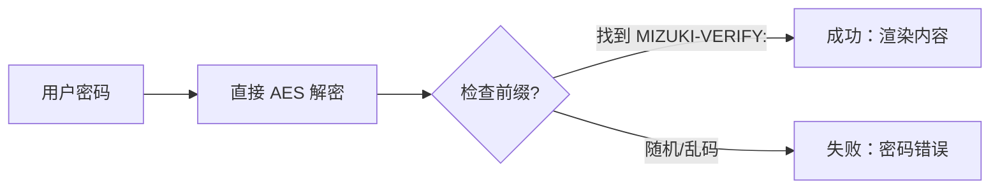
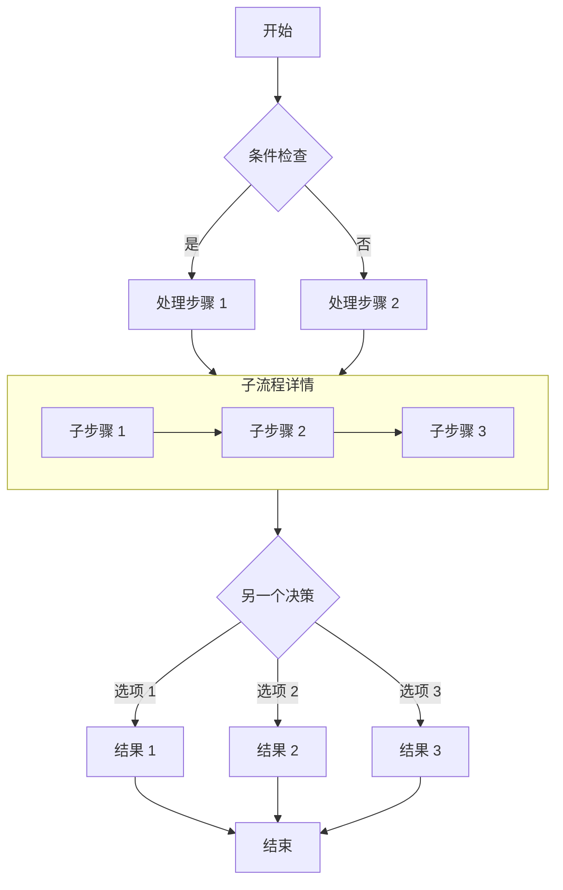
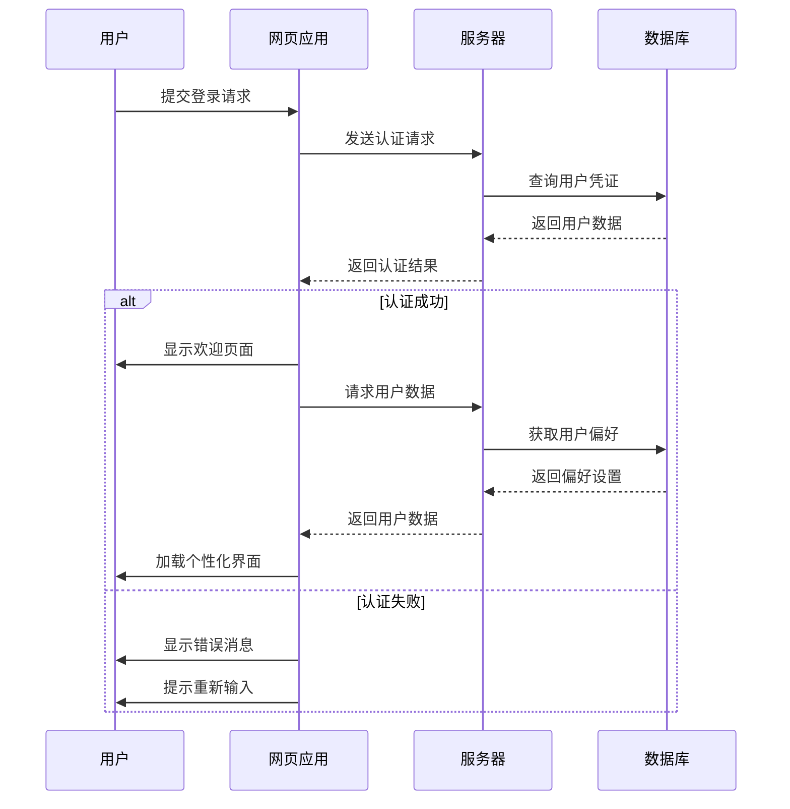
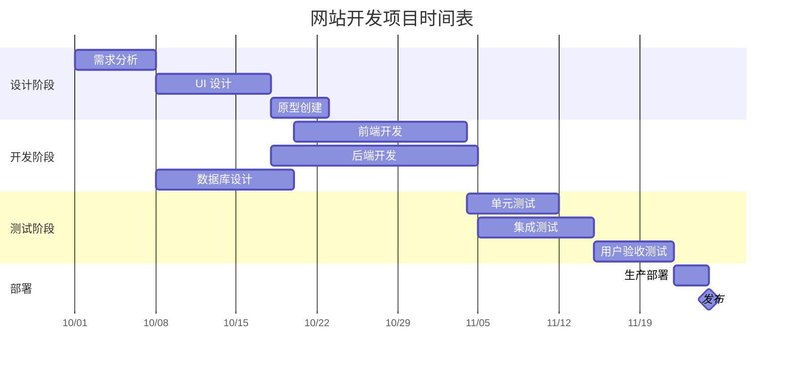
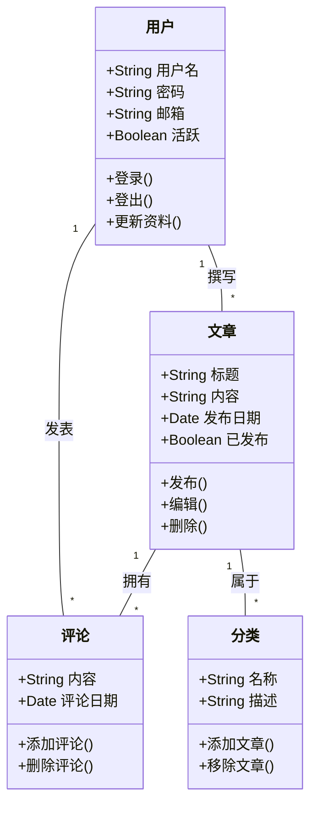
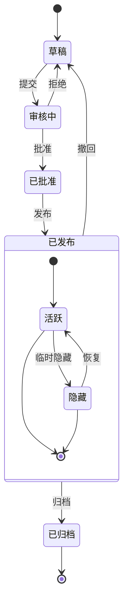
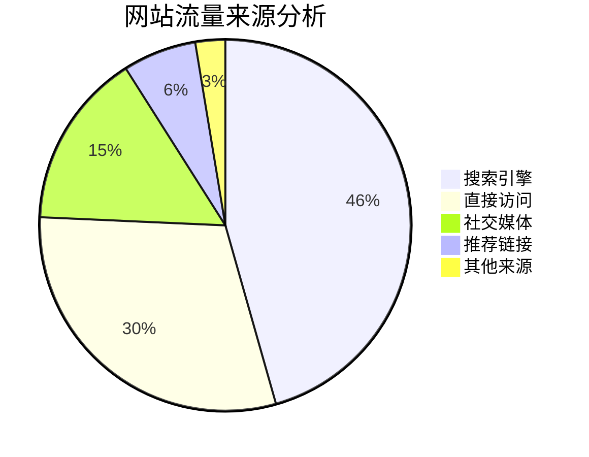

# 博客功能完整示例

这是一篇合并了所有示例文章的完整功能展示。本文包含了博客模板的所有主要功能，包括 Markdown 语法、扩展功能、Mermaid 图表、视频嵌入、图片画廊等。

---

## HuoLinBlog 使用指南

本博客模板基于 [Astro](https://astro.build/) 构建。如果你在本指南中找不到答案，可以在 [Astro 文档](https://docs.astro.build/) 中查找。

### Front-matter 配置

文章的 front-matter 示例：

```yaml
---
title: My First Blog Post
published: 2023-09-09
description: This is the first post of my new Astro blog.
image: ./cover.jpg
tags: [Foo, Bar]
category: Front-end
draft: false
---
```

#### 字段说明

| 字段          | 说明                                                                                                                             |
| ------------- | -------------------------------------------------------------------------------------------------------------------------------- |
| `title`       | 文章标题                                                                                                                         |
| `published`   | 发布日期                                                                                                                         |
| `pinned`      | 是否置顶到文章列表顶部                                                                                                           |
| `priority`    | 置顶优先级，值越小优先级越高（0, 1, 2...）                                                                                       |
| `description` | 文章简短描述，显示在首页                                                                                                         |
| `image`       | 封面图片路径：以 `http://` 或 `https://` 开头使用网络图片；以 `/` 开头为 public 目录下的图片；无前缀为相对于 markdown 文件的路径 |
| `tags`        | 文章标签                                                                                                                         |
| `category`    | 文章分类                                                                                                                         |
| `licenseName` | 文章内容许可证名称                                                                                                               |
| `author`      | 文章作者                                                                                                                         |
| `sourceLink`  | 文章来源链接或参考                                                                                                               |
| `draft`       | 是否为草稿（草稿不会显示）                                                                                                       |

### 文章文件存放位置

文章文件应放在 `src/content/posts/` 目录下。有两种方案：

#### 单文件方案 (Single File)

适合简单文章，直接创建 `.md` 文件：

```
src/content/posts/
├── post-1.md
├── post-2.md
└── post-3.md
```

访问地址：`http://localhost:3000/posts/post-1/`

**注意：** 单文件方案使用本地图片时，RSS 可能无法正常构建图片路径。

#### 文件夹方案 (Folder) - 推荐

适合图片较多的文章，每个文章一个文件夹：

```
src/content/posts/
├── post-1/
│   ├── cover.webp      # 封面图片
│   ├── image1.webp     # 文章图片
│   └── index.md        # 文章内容
└── post-2/
    └── index.md
```

**文件夹方案的优势：**

- ✅ RSS 可以正常构建图片路径
- ✅ 图片与文章一同打包部署
- ✅ 便于迁移和备份
- ✅ 完全控制图片，不依赖外部图床
- ✅ 无跨域加载延迟
- ✅ 隐私性好，零额外成本

**图片路径写法：**

```markdown
 # 相对于 index.md
 # 同上
 # public 目录下的图片
```

### 文章永久链接 (Permalink)

**Mizuki 7.2+ 新功能**，可以为文章设置固定 URL，提升 SEO。

在 front-matter 中添加 `permalink` 字段：

```yaml
---
title: 我的特殊文章
published: 2024-01-15
permalink: "my-special-article"
---
```

生成的 URL：`https://your-site.com/posts/my-special-article`

**与 alias 的区别：**

- `permalink`：7.2+ 新功能，专门用于 SEO 优化
- `alias`：兼容旧版本，功能类似

### 文章别名 (Posts Alias)

通过在 front-matter 中添加 `alias` 字段为文章设置自定义 URL：

```yaml
---
title: 我的特殊文章
published: 2024-01-15
alias: "my-special-article"
---
```

设置别名后：

- 文章可通过自定义 URL 访问（例如 `/posts/my-special-article/`）
- 默认的 `/posts/{slug}/` URL 仍然有效
- RSS/Atom 订阅将使用自定义别名
- 所有内部链接将自动使用自定义别名

**注意事项：**

- 别名不应包含 `/posts/` 前缀（会自动添加）
- 避免在别名中使用特殊字符和空格
- 建议使用小写字母和连字符以获得最佳 SEO 效果
- 确保所有文章的别名唯一

### 加密文章功能 (Page Encryption)

通过在 front-matter 中设置 `encrypted: true` 并提供 `password` 来为文章设置密码保护：

```yaml
---
title: 我的私密文章
published: 2024-01-15
encrypted: true
password: "my-secret-password"
passwordHint: "提示：密码是我家狗的名字"
hideHomeContent: true
---
```

#### 字段说明

| 字段              | 必填 | 说明                                                                    |
| ----------------- | ---- | ----------------------------------------------------------------------- |
| `encrypted`       | 是   | 设置为 `true` 启用密码保护                                              |
| `password`        | 是   | 解锁文章的密码                                                          |
| `passwordHint`    | 否   | 显示在密码输入框下方的提示                                              |
| `hideHomeContent` | 否   | 隐藏公开摘要，显示为"该文章已加密"。当设置了 `password` 时默认为 `true` |

#### 加密原理



### 草稿功能 (Draft)

在 front-matter 中设置 `draft: true`，文章将不会发布，对普通访客不可见。当文章准备发布时，将 `draft` 字段更新为 `false`。

---

## Markdown 基础语法

这是一个 Markdown 写作示例，展示了如何编写 markdown 文件。本文档整合了核心语法和扩展语法（GFM）。

### 块级元素 (Block Elements)

#### 段落和换行 (Paragraphs and Line Breaks)

##### 段落 (Paragraphs)

HTML 标签: `<p>`

一个或多个空行（只包含空格或制表符的行视为空行）。

代码 (Code):

    This will be
    inline.

    This is second paragraph.

预览 (Preview):

---

This will be
inline.

This is second paragraph.

---

##### 换行 (Line Breaks)

HTML 标签: `<br />`

在行尾添加**两个或更多空格**。

代码 (Code):

    This will be not
    inline.

预览 (Preview):

---

This will be not  
inline.

---

#### 标题 (Headers)

Markdown 支持两种标题样式：Setext 和 atx。

##### Setext 样式

HTML 标签: `<h1>`, `<h2>`

使用**等号 (=)** 作为 `<h1>`，**破折号 (-)** 作为 `<h2>`。

代码 (Code):

```
This is an H1
=============
This is an H2
-------------
```

渲染效果：`=` 下方的文字变为一级标题，`-` 下方的文字变为二级标题。

---

##### atx 样式

HTML 标签: `<h1>`, `<h2>`, `<h3>`, `<h4>`, `<h5>`, `<h6>`

在行首使用 1-6 个**井号 (#)**，对应 `<h1>` - `<h6>`。

代码 (Code):

```
# This is an H1
## This is an H2
###### This is an H6
```

渲染效果：`#` 生成一级标题，`##` 生成二级标题，`######` 生成六级标题。

---

可选地，你可以"关闭" atx 风格的标题。关闭的井号**不需要与**开启标题使用的井号数量匹配。

代码 (Code):

```
# This is an H1 #
## This is an H2 ##
### This is an H3 ######
```

渲染效果：关闭的井号会被忽略，标题级别由开头的井号数量决定。

---

#### 引用 (Blockquotes)

HTML 标签: `<blockquote>`

Markdown 使用电子邮件风格的 **>** 字符进行引用。最好在每行前面加上 >。

代码 (Code):

    > This is a blockquote with two paragraphs. Lorem ipsum dolor sit amet,
    > consectetuer adipiscing elit. Aliquam hendrerit mi posuere lectus.
    > Vestibulum enim wisi, viverra nec, fringilla in, laoreet vitae, risus.
    >
    > Donec sit amet nisl. Aliquam semper ipsum sit amet velit. Suspendisse
    > id sem consectetuer libero luctus adipiscing.

预览 (Preview):

---

> This is a blockquote with two paragraphs. Lorem ipsum dolor sit amet,
> consectetuer adipiscing elit. Aliquam hendrerit mi posuere lectus.
> Vestibulum enim wisi, viverra nec, fringilla in, laoreet vitae, risus.
>
> Donec sit amet nisl. Aliquam semper ipsum sit amet velit. Suspendisse
> id sem consectetuer libero luctus adipiscing.

---

Markdown 允许你偷懒，只在硬换行段落的第一行前面加上 >。

代码 (Code):

    > This is a blockquote with two paragraphs. Lorem ipsum dolor sit amet,
    consectetuer adipiscing elit. Aliquam hendrerit mi posuere lectus.
    Vestibulum enim wisi, viverra nec, fringilla in, laoreet vitae, risus.

    > Donec sit amet nisl. Aliquam semper ipsum sit amet velit. Suspendisse
    id sem consectetuer libero luctus adipiscing.

预览 (Preview):

---

> This is a blockquote with two paragraphs. Lorem ipsum dolor sit amet,
> consectetuer adipiscing elit. Aliquam hendrerit mi posuere lectus.
> Vestibulum enim wisi, viverra nec, fringilla in, laoreet vitae, risus.

> Donec sit amet nisl. Aliquam semper ipsum sit amet velit. Suspendisse
> id sem consectetuer libero luctus adipiscing.

---

引用可以嵌套（即引用中的引用），通过添加额外的 > 级别。

代码 (Code):

    > This is the first level of quoting.
    >
    > > This is nested blockquote.
    >
    > Back to the first level.

预览 (Preview):

---

> This is the first level of quoting.
>
> > This is nested blockquote.
>
> Back to the first level.

---

引用可以包含其他 Markdown 元素，包括标题、列表和代码块。

代码 (Code):

```
> ## This is a header.
>
> 1.   This is the first list item.
> 2.   This is the second list item.
>
> Here's some example code:
>
>     return shell_exec("echo $input | $markdown_script");
```

渲染效果：引用块内可以包含标题（`##`）、有序列表（`1.`）和代码块（缩进 4 空格）。

---

#### 列表 (Lists)

Markdown 支持有序（编号）和无序（项目符号）列表。

##### 无序列表 (Unordered)

HTML 标签: `<ul>`

无序列表使用**星号 (\*)**、**加号 (+)** 和**连字符 (-)**。

代码 (Code):

    *   Red
    *   Green
    *   Blue

预览 (Preview):

---

- Red
- Green
- Blue

---

等同于：

代码 (Code):

    +   Red
    +   Green
    +   Blue

和：

代码 (Code):

    -   Red
    -   Green
    -   Blue

##### 有序列表 (Ordered)

HTML 标签: `<ol>`

有序列表使用数字后跟句点：

代码 (Code):

    1.  Bird
    2.  McHale
    3.  Parish

预览 (Preview):

---

1.  Bird
2.  McHale
3.  Parish

---

可能会意外触发有序列表，比如这样写：

代码 (Code):

    1986. What a great season.

预览 (Preview):

---

1986. What a great season.

---

你可以用**反斜杠转义 (\\)** 句点：

代码 (Code):

    1986\. What a great season.

预览 (Preview):

---

1986\. What a great season.

---

##### 缩进列表

###### 列表中的引用

要在列表项中放置引用，引用的 > 分隔符需要缩进：

代码 (Code):

    *   A list item with a blockquote:

        > This is a blockquote
        > inside a list item.

预览 (Preview):

---

- A list item with a blockquote:

  > This is a blockquote
  > inside a list item.

---

###### 列表中的代码块

要在列表项中放置代码块，代码块需要缩进两次 —— **8 个空格** 或 **两个制表符**：

代码 (Code):

    *   A list item with a code block:

            <code goes here>

预览 (Preview):

---

- A list item with a code block:

      <code goes here>

---

###### 嵌套列表

代码 (Code):

    * A
      * A1
      * A2
    * B
    * C

预览 (Preview):

---

- A
  - A1
  - A2
- B
- C

---

#### 代码块 (Code Blocks)

HTML 标签: `<pre>`

将每行缩进至少 **4 个空格** 或 **1 个制表符**。

代码 (Code):

    This is a normal paragraph:

        This is a code block.

预览 (Preview):

---

This is a normal paragraph:

    This is a code block.

---

代码块持续到它到达未缩进的行（或文章结束）。

在代码块中，**_& 符号 (&)_** 和**尖括号 (< 和 >)** 会自动转换为 HTML 实体。

代码 (Code):

        <div class="footer">
            &copy; 2004 Foo Corporation
        </div>

预览 (Preview):

---

    <div class="footer">
        &copy; 2004 Foo Corporation
    </div>

---

以下部分围栏代码块和语法高亮是扩展功能，你可以用另一种方式编写代码块。

##### 围栏代码块 (Fenced Code Blocks)

只需用 ` ``` ` 包裹你的代码（如下所示），就无需缩进四个空格。

代码 (Code):

    Here's an example:

    ```
    function test() {
      console.log("notice the blank line before this function?");
    }
    ```

预览 (Preview):

---

Here's an example:

```
function test() {
  console.log("notice the blank line before this function?");
}
```

---

##### 语法高亮 (Syntax Highlighting)

在围栏代码块中，添加可选的语言标识符，我们将对其进行语法高亮（[支持的语言](https://github.com/github/linguist/blob/master/lib/linguist/languages.yml)）。

代码 (Code):

    ```ruby
    require 'redcarpet'
    markdown = Redcarpet.new("Hello World!")
    puts markdown.to_html
    ```

预览 (Preview):

---

```ruby
require 'redcarpet'
markdown = Redcarpet.new("Hello World!")
puts markdown.to_html
```

---

#### 水平线 (Horizontal Rules)

HTML 标签: `<hr />`

在单独的行上放置**三个或更多连字符 (-)、星号 (\*) 或下划线 (\_)**。可以在连字符或星号之间使用空格。

代码 (Code):

    * * *
    ***
    *****
    - - -
    ---------------------------------------
    ___

预览 (Preview):

---

---

---

---

---

---

---

---

#### 表格 (Table)

HTML 标签: `<table>`

这是一个扩展功能。

使用**管道符 (|)** 分隔列，**破折号 (-)** 分隔表头，**冒号 (:)** 用于对齐。

外层**管道符 (|)** 和对齐是可选的。每个单元格至少需要 **3 个分隔符** 来分隔表头。

代码 (Code):

```
| Left | Center | Right |
|:-----|:------:|------:|
|aaa   |bbb     |ccc    |
|ddd   |eee     |fff    |

 A | B
---|---
123|456


A |B
--|--
12|45
```

预览 (Preview):

---

| Left | Center | Right |
| :--- | :----: | ----: |
| aaa  |  bbb   |   ccc |
| ddd  |  eee   |   fff |

| A   | B   |
| --- | --- |
| 123 | 456 |

| A   | B   |
| --- | --- |
| 12  | 45  |

---

### 行内元素 (Span Elements)

#### 链接 (Links)

HTML 标签: `<a>`

Markdown 支持两种链接样式：行内和引用。

##### 行内链接 (Inline)

行内链接格式：`[链接文本](URL "标题")`

标题是可选的。

代码 (Code):

    This is [an example](http://example.com/ "Title") inline link.

    [This link](http://example.net/) has no title attribute.

预览 (Preview):

---

This is [an example](http://example.com/ "Title") inline link.

[This link](http://example.net/) has no title attribute.

---

如果你引用的是同一服务器上的本地资源，可以使用相对路径：

代码 (Code):

    See my [About](/about/) page for details.

预览 (Preview):

---

See my [About](/about/) page for details.

---

##### 引用链接 (Reference)

你可以预定义链接引用。格式：`[id]: URL "标题"`

标题也是可选的。然后你引用链接，格式：`[链接文本][id]`

代码 (Code):

    [id]: http://example.com/  "Optional Title Here"
    This is [an example][id] reference-style link.

预览 (Preview):

---

[id]: http://example.com/ "Optional Title Here"

This is [an example][id] reference-style link.

---

即：

- 方括号包含链接标识符（**不区分大小写**，可选地从左边距缩进最多三个空格）；
- 后跟冒号；
- 后跟一个或多个空格（或制表符）；
- 后跟链接的 URL；
- 链接 URL 可选地用尖括号包围；
- 可选地后跟链接的 title 属性，用双引号、单引号或括号包围。

以下三个链接定义是等价的：

代码 (Code):

    [foo]: http://example.com/  "Optional Title Here"
    [foo]: http://example.com/  'Optional Title Here'
    [foo]: http://example.com/  (Optional Title Here)
    [foo]: <http://example.com/>  "Optional Title Here"

使用空方括号，链接文本本身用作名称。

代码 (Code):

    [Google]: http://google.com/
    [Google][]

预览 (Preview):

---

[Google]: http://google.com/

[Google][]

---

#### 强调 (Emphasis)

HTML 标签: `<em>`, `<strong>`

Markdown 将**星号 (\*)** 和**下划线 (\_)** 视为强调标记。**单个分隔符** 将生成 `<em>`；**双分隔符** 将生成 `<strong>`。

代码 (Code):

    *single asterisks*

    _single underscores_

    **double asterisks**

    __double underscores__

预览 (Preview):

---

_single asterisks_

_single underscores_

**double asterisks**

**double underscores**

---

但如果你用空格包围 \* 或 \_，它将被视为字面量星号或下划线。

你可以用反斜杠转义它：

代码 (Code):

    \*this text is surrounded by literal asterisks\*

预览 (Preview):

---

\*this text is surrounded by literal asterisks\*

---

#### 行内代码 (Code)

HTML 标签: `<code>`

用**反引号 (`)** 包裹。

代码 (Code):

    Use the `printf()` function.

预览 (Preview):

---

Use the `printf()` function.

---

要在代码段中包含字面量反引号字符，可以使用**多个反引号**作为开头和结尾分隔符：

代码 (Code):

    ``There is a literal backtick (`) here.``

预览 (Preview):

---

``There is a literal backtick (`) here.``

---

围绕代码段的反引号分隔符可以包含空格 —— 开头一个，结尾一个。这允许你在代码段的开头或结尾放置字面量反引号字符：

代码 (Code):

    A single backtick in a code span: `` ` ``

    A backtick-delimited string in a code span: `` `foo` ``

预览 (Preview):

---

A single backtick in a code span: `` ` ``

A backtick-delimited string in a code span: `` `foo` ``

---

#### 图片 (Images)

HTML 标签: ``

Markdown 使用类似链接的图片语法，支持两种样式：行内和引用。

##### 行内图片 (Inline)

行内图片语法：``

标题是可选的。

代码 (Code):

    

    

预览 (Preview):

---


---

即：

- 感叹号: !;
- 后跟一组方括号，包含图片的 alt 属性文本；
- 后跟一组圆括号，包含图片的 URL 或路径，以及可选的 title 属性（用双引号或单引号包围）。

##### 图片宽度参数 (Image Width)

**Mizuki 8.0+ 功能**，可以在图片语法中设置宽度百分比：

语法：``

代码 (Code):

    

    

参数说明：

- `w-50%`：设置图片宽度为 50%（可以是任意百分比值）
- `"图片标题"`：可选的标题/说明文字

##### 引用图片 (Reference)

引用样式图片语法：`![替代文本][id]`

代码 (Code):

    [img id]: https://s2.loli.net/2024/08/20/5fszgXeOxmL3Wdv.webp  "Optional title attribute"
    ![Alt text][img id]

预览 (Preview):

---

[img id]: https://s2.loli.net/2024/08/20/5fszgXeOxmL3Wdv.webp "Optional title attribute"

![Alt text][img id]

---

#### 删除线 (Strikethrough)

HTML 标签: `<del>`

这是一个扩展功能。

GFM 添加了删除线文本语法。

代码 (Code):

```
~~Mistaken text.~~
```

预览 (Preview):

---

~~Mistaken text.~~

---

### 其他 (Miscellaneous)

#### 自动链接 (Automatic Links)

Markdown 支持一种快捷方式来创建 URL 和电子邮件地址的"自动"链接：只需用尖括号包围 URL 或电子邮件地址。

代码 (Code):

    <http://example.com/>

    <address@example.com>

预览 (Preview):

---

<http://example.com/>

<address@example.com>

---

GFM 将自动链接标准 URL。

代码 (Code):

```
https://github.com/emn178/markdown
```

预览 (Preview):

---

https://github.com/emn178/markdown

---

#### 反斜杠转义 (Backslash Escapes)

Markdown 允许你使用反斜杠转义来生成在 Markdown 格式语法中具有特殊意义的字面量字符。

代码 (Code):

    \*literal asterisks\*

预览 (Preview):

---

\*literal asterisks\*

---

Markdown 为以下字符提供反斜杠转义：

代码 (Code):

    \   backslash（反斜杠）
    `   backtick（反引号）
    *   asterisk（星号）
    _   underscore（下划线）
    {}  curly braces（花括号）
    []  square brackets（方括号）
    ()  parentheses（圆括号）
    #   hash mark（井号）
    +   plus sign（加号）
    -   minus sign (hyphen)（减号/连字符）
    .   dot（句点）
    !   exclamation mark（感叹号）

### 编辑器快捷键 (Keyboard Shortcuts)

| 功能          | Windows/Linux | Mac   |
| ------------- | ------------- | ----- |
| 加粗 (Bold)   | Ctrl + B      | ⌘ + B |
| 斜体 (Italic) | Ctrl + I      | ⌘ + I |
| 链接 (Link)   | Ctrl + K      | ⌘ + K |

### 行内 HTML (Inline HTML)

对于 Markdown 语法未涵盖的任何标记，你只需使用 HTML 本身。无需前缀或分隔符来指示你正在从 Markdown 切换到 HTML；只需使用标签。

代码 (Code):

    This is a regular paragraph.

    <table>
        <tr>
            <td>Foo</td>
        </tr>
    </table>

    This is another regular paragraph.

预览 (Preview):

---

This is a regular paragraph.

<table>
    <tr>
        <td>Foo</td>
    </tr>
</table>

This is another regular paragraph.

---

请注意，Markdown 格式语法**在块级 HTML 标签内不会被处理**。

与块级 HTML 标签不同，Markdown 语法**在行内标签内会被处理**。

代码 (Code):

    <span>**Work**</span>

    <div>
        **No Work**
    </div>

预览 (Preview):

---

<span>**Work**</span>

<div>
  **No Work**
</div>

---

## 扩展功能 (Extended Features)

### GitHub 仓库卡片

你可以添加动态卡片链接到 GitHub 仓库，页面加载时会从 GitHub API 拉取仓库信息。

::github{repo="PuppyHuoLin/Astro_HuoLinBlog"}

创建 GitHub 仓库卡片的代码：`::github{repo="PuppyHuoLin/Astro_HuoLinBlog"}`

```markdown
::github{repo="PuppyHuoLin/Astro_HuoLinBlog"}
```

### 提示框 (Admonitions)

支持以下类型的提示框：`note` `tip` `important` `warning` `caution`

:::note
需要注意的信息，即使在浏览时也要注意。
:::

:::tip
可选信息，帮助用户更成功。
:::

:::important
用户成功所必需的关键信息。
:::

:::warning
由于潜在风险，需要用户立即注意的关键内容。
:::

:::caution
操作的负面潜在后果。
:::

#### 基础语法

```markdown
:::note
需要注意的信息...
:::

:::tip
可选信息...
:::
```

#### 自定义标题

:::note[自定义标题]
这是一个带有自定义标题的提示框。
:::

```markdown
:::note[自定义标题]
这是一个带有自定义标题的提示框。
:::
```

#### GitHub 语法

> [!TIP]
> [GitHub 语法](https://github.com/orgs/community/discussions/16925) 也支持。

```
> [!NOTE]
> GitHub 语法也支持。

> [!TIP]
> GitHub 语法也支持。
```

### 剧透 (Spoiler)

你可以为文本添加剧透效果。文本也支持 **Markdown** 语法。

内容 :spoiler[是隐藏的 **ayyy**]!

```markdown
内容 :spoiler[是隐藏的 **ayyy**]!
```

---

## Mermaid 图表

### 流程图

流程图非常适合表示流程或算法步骤。



### 时序图

时序图显示对象随时间的交互。



### 甘特图

甘特图非常适合显示项目时间表和时间线。



### 类图

类图显示系统的静态结构，包括类、属性、方法及其关系。



### 状态图

状态图显示对象在其生命周期中经历的状态序列。



### 饼图

饼图非常适合显示比例和百分比数据。



---

## 视频嵌入 (Video)

只需从 YouTube 或其他平台复制嵌入代码，粘贴到 markdown 文件中即可。

```yaml
---
title: Include Video in the Post
published: 2023-10-19
// ...
---

<iframe width="100%" height="468" src="https://www.youtube.com/embed/5gIf0_xpFPI?si=N1WTorLKL0uwLsU_" title="YouTube video player" frameborder="0" allowfullscreen></iframe>
```

### YouTube

<iframe width="100%" height="468" src="https://www.youtube.com/embed/5gIf0_xpFPI?si=N1WTorLKL0uwLsU_" title="YouTube video player" frameborder="0" allow="accelerometer; autoplay; clipboard-write; encrypted-media; gyroscope; picture-in-picture; web-share" allowfullscreen></iframe>

### Bilibili

<iframe width="100%" height="468" src="//player.bilibili.com/player.html?bvid=BV1fK4y1s7Qf&p=1&autoplay=0" scrolling="no" border="0" frameborder="no" framespacing="0" allowfullscreen="true" &autoplay=0> </iframe>

---

## 文章别名 (Posts Alias)

你可以通过在 front-matter 中添加 `alias` 字段为任何文章设置别名：

```yaml
---
title: 我的特殊文章
published: 2024-01-15
alias: "my-special-article"
tags: ["Example"]
category: "Technology"
---
```

设置别名后：

- 文章将可通过自定义 URL 访问（例如 `/posts/my-special-article/`）
- 默认的 `/posts/{slug}/` URL 仍然有效
- RSS/Atom 订阅将使用自定义别名
- 所有内部链接将自动使用自定义别名

**重要说明：**

- 别名不应包含 `/posts/` 前缀（会自动添加）
- 避免在别名中使用特殊字符和空格
- 建议使用小写字母和连字符以获得最佳 SEO 效果
- 确保所有文章的别名唯一
- 不要包含前导或尾随斜杠

---

## 加密文章功能 (Page Encryption)

你可以通过在 front-matter 中设置 `encrypted: true` 并提供 `password` 来为任何文章设置密码保护：

```yaml
---
title: 我的私密文章
published: 2024-01-15
encrypted: true
password: "my-secret-password"
passwordHint: "提示：密码是我家狗的名字"
hideHomeContent: true
---
```

### 字段说明

| 字段              | 必填 | 描述                                                                                                     |
| ----------------- | ---- | -------------------------------------------------------------------------------------------------------- |
| `encrypted`       | 是   | 设置为 `true` 启用密码保护                                                                               |
| `password`        | 是   | 解锁文章的密码                                                                                           |
| `passwordHint`    | 否   | 显示在密码输入框下方的提示                                                                               |
| `hideHomeContent` | 否   | 隐藏公开摘要，显示为"该文章已加密"。当设置了 `password` 时默认为 `true`。设置为 `false` 以显示正常摘要。 |

### 解锁框外观

解锁框显示：

- 主题主色的锁图标
- 文章标题 "Password Protected"
- 要求输入密码的描述
- 密码提示（如果提供了 `passwordHint`）
- 密码输入框和解锁按钮

输入正确密码后，内容将被解密并显示。密码存储在会话存储中，因此用户在同一会话内的后续页面加载中无需重新输入。

### 加密原理


---

## 草稿功能 (Draft Example)

这篇文章展示了草稿功能。在 front-matter 中设置 `draft: true`，文章将不会发布，对普通访客不可见。

当文章准备发布时，只需在 Frontmatter 中将 `draft` 字段更新为 `false`：

```markdown
---
title: 草稿示例
published: 2024-01-11T04:40:26.381Z
tags: [Markdown, Blogging, Demo]
category: Examples
draft: false
---
```

---

## 图片画廊 (Image Gallery Grid)

`:::grid` 是博客的图片画廊容器指令。它将普通 Markdown 图片排列成响应式网格，具有统一的纵横比，并自动启用灯箱查看功能。适用于文章图片、截图、作品集或小型相册。

> 本文既是功能文档也是视觉测试页面。在桌面、平板和手机宽度下查看示例，然后点击任意图片验证灯箱分组。

### 最小语法

在 `:::grid` 和结束 `:::` 之间直接写 Markdown 图片：

```markdown
:::grid


:::
```

每张图片必须单独成段，图片之间有空行。画廊中只保留图片；段落、列表和代码块写在容器外面。

### 参数概览

在开括号后的花括号中写入所有参数：`:::grid{parameter="value"}`。

| 参数      | 允许的值                          | 默认值  | 用途                                                               |
| --------- | --------------------------------- | ------- | ------------------------------------------------------------------ |
| `columns` | `1` 到 `6` 的整数                 | `3`     | 桌面端每行的列数。无效值回退为 `3`。                               |
| `aspect`  | 正数比例，如 `16/9`、`3/4`、`1/1` | `16/10` | 显示的卡片比例，不是原始图片比例。                                 |
| `fit`     | `cover`、`contain`                | `cover` | 图片适应模式。`cover` 裁剪填充；`contain` 保留完整图片，可能留空。 |

完整示例：

```markdown
:::grid{columns="3" aspect="16/9" fit="cover"}


:::
```

:::grid{columns="3" aspect="16/9" fit="cover"}


:::

### 标题和替代文本

图片的替代文本既用作无障碍替代文本，也用作默认标题。当图片有可选标题时，标题用作标题：

```markdown

```

在同一行中，标题对齐到每张卡片的底部。

:::grid{columns="3" aspect="1/1"}


:::

### 布局和裁剪

桌面布局使用 `columns` 指定的列数。低于 `768px` 时，网格最多使用两列；低于 `480px` 时，切换为一列。卡片包装器固定 `aspect` 比例并裁剪圆角，图片填充卡片而不使用主题的默认图片边距。

- 选择 `cover`：推荐默认。图片从中心裁剪以填充卡片，使画廊看起来一致。
- 选择 `contain`：显示完整原始图片，不裁剪。当其比例与卡片不同时，主题背景保持可见；用于不能裁剪的图片。
- 要保留完整图片而不留空，将 `aspect` 设置为接近原始图片比例，或将图片放在自己的网格中。

以下示例将相同的纵向图片放在 `16/9` 卡片中，使用 `cover` 和 `contain`。第一个裁剪它们；第二个保留完整图片并留出背景空间。

:::grid{columns="3" aspect="16/9" fit="cover"}


:::

:::grid{columns="3" aspect="16/9" fit="contain"}


:::

### 默认配置

没有属性时，默认为三列、`16/10` 比例和 `cover` 裁剪。这三张纵向图片验证默认裁剪和标题。

:::grid


:::

### 三列纵向：3:4

使用 `aspect="3/4"`，三张纵向图片填充比例一致的垂直卡片。如果原始图片比例不同，`cover` 从中心裁剪其边缘。

:::grid{columns="3" aspect="3/4"}


:::

### 三列风景：16:9

此集合在三列布局中演示了常见的视频封面比例。当风景图片接近卡片比例时，裁剪最小。

:::grid{columns="3" aspect="16/9"}


:::

### 两列方形：1:1

两列适用于需要更大预览卡片的情况。第三张图片移到下一行。最后一行保持其网格轨道宽度而不是拉伸图片以填充行。

:::grid{columns="2" aspect="1/1"}


:::

### 四列包含：contain

`fit="contain"` 不裁剪原始图片。当图片比例与卡片比例不同时，主题背景保持可见。这是有意为之，不是布局问题。它还验证了四列网格和独立灯箱组不会相互干扰。

:::grid{columns="4" aspect="16/9" fit="contain"}


:::

### 单列详情图片

一列适用于需要更大阅读尺寸的图片。它在桌面、平板和手机上保持一列，原始图片仍可在灯箱中使用。

:::grid{columns="1" aspect="16/9"}

:::

### 稀疏五行

五行验证了更高的支持列数。只有三张图片时，最后一行保持左对齐而不是拉伸图片。

:::grid{columns="5" aspect="1/1"}


:::

### 六列混合图片

六列是当前最大值。混合风景和纵向图片验证 `cover` 裁剪、窄卡片上的标题和密集桌面布局。对于可读的文章内容，两到四列通常更可取。

:::grid{columns="6" aspect="1/1"}


:::

### 四列方形：1:1

四张相同比例的方形图片是典型的四列布局。桌面显示全部四张在一行；平板折叠为两列，手机为一列。

:::grid{columns="4" aspect="1/1"}


:::

### 六列风景：16:9

六列风景适用于缩略图预览、作品集和截图索引。即使原始比例略有不同，`cover` 也能一致地填充每个 `16/9` 卡片。

:::grid{columns="6" aspect="16/9"}


:::

### 三列纵向：3:4（六张）

这组六张纵向图片演示了人物、海报或手机截图的常见布局。图片形成两行三列，标题对齐到底部。

:::grid{columns="3" aspect="3/4"}


:::

### 边缘关键内容：cover 和灯箱

这些图片在其边缘包含重要文本或细节。`cover` 保持网格整洁但可能裁剪这些边缘；点击图片可在灯箱中查看未裁剪的原始图片。对边缘敏感的图片使用清晰的标题，或使用下面的 `contain`。

:::grid{columns="3" aspect="16/9" fit="cover"}


:::

### 极端比例使用 contain

对于横幅、长截图和其他极端图片比例，`contain` 显示完整的原始图片。与 `cover` 不同，它可能留出主题背景空间，但永远不会裁剪内容。

:::grid{columns="3" aspect="16/9" fit="contain"}


:::

### 透明图片

透明图片显示卡片的主题背景。此单列 `contain` 示例使透明区域、原始边缘和灯箱行为易于检查。

:::grid{columns="1" aspect="16/9" fit="contain"}

:::

### 灯箱导航

点击网格中的任何图片可打开 Fancybox 灯箱。在那里你可以缩放、旋转、全屏、查看缩略图，并使用箭头键导航。导航仅限于当前 `:::grid` 容器：例如，点击"16:9 测试图片一"只会打开该部分中的其他两张风景图片。

同一文章中的普通 Markdown 图片继续单独处理；它们不会添加到任何网格画廊中。

---

_本文合并了 HuoLinBlog 主题的所有示例文章，展示了博客的完整功能。_
